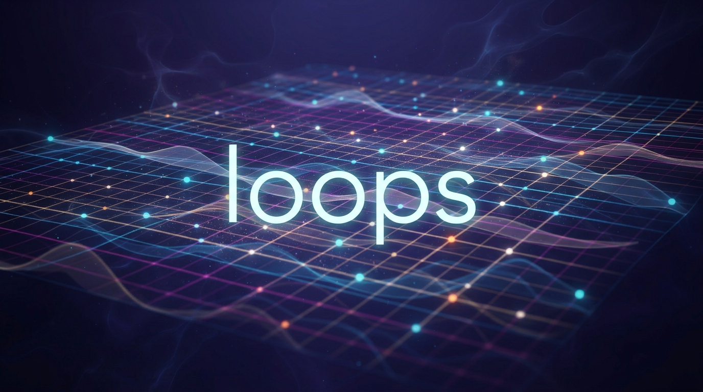

<h1 align="center">
  
</h1>

A small toolkit for playing looped beats and patterns in the browser, built on the Web Audio API.

`loops` keeps track of *when* things should happen in a loop — it doesn't make any sound itself. You tell it what a loop looks like (a JSON object describing bars, tempo, and a handful of notes per channel), and it calls you back at the right moment so you can play a sample, trigger a synth, or do anything else that makes noise.

It's designed to work well with modern UI frameworks like React.

## Why it exists

Drum machines, step sequencers, and beat makers all need the same thing underneath: a clock that counts time accurately, and a way to say "play this sound at this moment, and keep repeating the pattern." Getting that right — without glitches, without drift, and without dropped or doubled notes when someone edits the pattern mid-playback — is the hard part. `loops` solves that once, so the rest of an app can focus on the interesting parts: the interface, the sounds, the creative tools.

## The core ideas

**A loop is just data.** A loop is a plain object — bars, tempo, and a set of "channels" (think: kick, snare, hi-hat), each holding a short list of notes and the tick at which they play. Because it's plain data, saving a beat is as simple as turning it into JSON text, and loading one is just reading that text back in. There's no hidden state to worry about.

**The library plays the clock, not the sound.** `loops` watches time and tells you exactly when each note should happen — but it never touches speakers, samples, or synthesizers itself. That part is entirely up to you. This means it works just as well for a drum sample as it does for a synthesized tone, a MIDI message, or a custom sound effect you build yourself.

**Editing while playing just works.** Toggle a step, mute a channel, change the tempo — all while the loop is playing — and it keeps going smoothly. Changes take effect on the very next pass through the loop, with no clicks, skips, or repeated notes. This was one of the trickiest problems to get right, and it's a big part of why this library exists.

**Each piece does one job.** Under the hood, the library is split into small, independent pieces: one converts between musical time and real time, one keeps track of what's due to play next, one runs the actual scheduling loop. None of them know about the others' internals, which makes the whole thing easier to trust and easier to test.

**React is a thin layer on top.** If you're building with React, a small set of hooks lets a component simply ask "what's playing on this channel right now?" and re-render when it changes — no manual subscriptions or cleanup to manage.

## A couple of examples

Here's a loop with a four-on-the-floor kick and a snare on the backbeat, described with `core` alone:

```ts
import { createTransport, steps } from "@loops/core";

const loop = {
  version: 1,
  bars: 1,
  beatsPerBar: 4,
  tempo: 120,
  channels: {
    kick: steps("x...x...x...x...", { stepTicks: 24 }),
    snare: steps("....x.......x...", { stepTicks: 24 }),
  },
};

const transport = createTransport({ clock, timer }); // your own Clock and Timer
transport.channel("kick", (e) => playKickSound(e.time));
transport.channel("snare", (e) => playSnareSound(e.time));

transport.setLoop(loop);
transport.start();
```

`steps()` turns a simple string into the right notes for you — `x` plays, `.` rests — so you rarely have to think about tick numbers directly. Each `channel()` call just says "call this function whenever this channel has something to play."

In a React app, `@loops/react` wraps that same transport in a provider and a couple of hooks:

```tsx
import { TransportProvider, useChannel } from "@loops/react";

function Kick() {
  useChannel("kick", (e) => playKickSound(e.time));
  return null;
}

function BeatMachine({ loop }) {
  return (
    <TransportProvider clock={clock} timer={timer} loop={loop}>
      <Kick />
    </TransportProvider>
  );
}
```

`useChannel` subscribes a component to one channel's notes for as long as it's mounted, and cleans itself up automatically when it isn't. The example drum machine (`examples/drum-machine`) is a fuller version of this same pattern, with a UI for editing the loop built on top.

## What's in this repository

- **`packages/core`** — the engine: loop data, the scheduler, and the timing math. No dependencies, works anywhere JavaScript runs.
- **`packages/react`** — React hooks and components built on top of `core`.
- **`packages/web-audio`** — a few small helpers for connecting the scheduler to the browser's audio clock.
- **`examples/drum-machine`** — a working drum machine built with all three, used as a demonstration and a testing ground for new ideas.

## Trying it out

This is a [pnpm](https://pnpm.io) workspace. From the repository root:

```sh
pnpm install
pnpm --filter drum-machine dev
```

That starts the example drum machine locally, where you can program a beat, play it back, tweak it live, and export it as JSON to save or share.

The example's styling comes from [`tailwind-topcoat`](https://github.com/tadger/tailwind-topcoat), installed straight from GitHub. While both repos are private, installing needs GitHub HTTPS credentials with access to that repo (for example `gh auth login`, or a stored credential helper); this goes away when they become public, and note that it applies to the whole workspace's `pnpm install`. To iterate on the theme locally, temporarily run `pnpm --filter drum-machine add link:../../../tailwind-topcoat`; don't commit that change. When you're done, `git restore examples/drum-machine/package.json pnpm-lock.yaml` and `pnpm install` put the git version back, and `pnpm --filter drum-machine update tailwind-topcoat` moves the pin to the theme's latest `main`.

## What this is not (yet)

This is an early-stage toolkit, not a full music production framework. It doesn't do swing or groove timing, chained patterns or song arrangement, MIDI input or output, or ship with any instruments or effects — those are all left to whoever builds on top of it, or may arrive in a later version.
